  

Computer science student nearing graduation. I work on machine learning and LLM-based tools in Python, build APIs with FastAPI, and develop applications with Next.js, C#, and ASP.NET Core.

[Email](mailto:fahimishmam.fm@gmail.com) | [LinkedIn](https://www.linkedin.com/in/fahim-mubarrat-ishmam/) | [Portfolio](https://ishmam.free.nf) | [Seatz Live Demo](https://seatz-h5ena4f4fxdrfwen.indiasouthcentral-01.azurewebsites.net/) | [Insurance Estimator Live Demo](https://insurance-tier-model.vercel.app/)

---

## About

- Interested in machine learning, applied AI, and LLM-powered applications.
- Experience with Python, data analysis, and scikit-learn.
- Built and deployed a machine learning application using FastAPI and Next.js.
- Built automated pipelines combining LLM APIs (Groq), content processing, and image generation.
- Build backend applications with C#, ASP.NET Core, Entity Framework Core, and PostgreSQL.
- Graphics programming in C++ with OpenGL.

## Skills

**Languages**

**Backend, Databases & Tools**

       

**Machine Learning & Data Science**

   

**LLM & AI Development**

  

**Currently Learning**

  

Also: Entity Framework Core, SQL Server, REST APIs, and OpenGL.

---

## Projects

### Seatz

A seat reservation platform built with ASP.NET Core MVC. Vendors can create and manage venue layouts using a visual seat editor with per-seat pricing and 360-degree seat images. Customers can browse layouts, preview seats in 360 degrees, and complete a demo checkout as guests or registered users.

Payment is simulated.

**Tech stack:** ASP.NET Core MVC, Entity Framework Core, PostgreSQL (Neon), Pannellum, Azure.

[Live Demo](https://seatz-h5ena4f4fxdrfwen.indiasouthcentral-01.azurewebsites.net/) | [Source Code](https://github.com/Ishmam21/Seat-Booking)

  

### Insurance Premium Estimator

A machine learning application that predicts low, medium, or high insurance premium categories from age, income, smoking status, city, occupation, and body measurements. The Next.js frontend displays live BMI calculations and prediction results. The FastAPI backend validates inputs with Pydantic, derives model features, and runs a saved scikit-learn preprocessing and Random Forest pipeline.

A learning demo that predicts premium categories, not monetary insurance quotes. Frontend hosted on Vercel and backend on Render.

**Tech stack:** Python, FastAPI, Pydantic, scikit-learn, pandas, Next.js, TypeScript, Vercel, Render.

[Live Demo](https://insurance-tier-model.vercel.app/) | [Source Code](https://github.com/Ishmam21/Insurance-Tier-Model) | [API Docs](https://insurance-tier-model.onrender.com/docs)

  

### ChatBotLocal

A local restaurant review chatbot built with LangChain and Ollama. Customer reviews are embedded using mxbai-embed-large and stored in a persistent Chroma vector database. For each question, the app retrieves up to five relevant reviews and passes them to Qwen2.5 to generate an answer using retrieval-augmented generation (RAG).

Runs in the terminal with local models and no cloud API key.

**Tech stack:** Python, LangChain, Ollama, Chroma, pandas, Qwen2.5, mxbai-embed-large.

[Source Code](https://github.com/Ishmam21/ChatBotLocal)

  

---
## GitHub

  

---

Graduating in December 2026. Open to junior machine learning, AI engineering, and software engineering opportunities.
