  

Computer science student, close to graduating. I build backend and full-stack apps with C# and ASP.NET Core, and I'm into machine learning: LLM APIs, model training, and Python. I also work on graphics programming and databases.

[Email](mailto:YOUR_EMAIL) | [LinkedIn](https://www.linkedin.com/in/YOUR_HANDLE) | [Portfolio](https://ishmam.free.nf) | [Seatz live demo](https://seatz-h5ena4f4fxdrfwen.indiasouthcentral-01.azurewebsites.net/)

---

## About

- Building backend and full-stack apps with C#, ASP.NET Core, EF Core, and PostgreSQL
- Passionate about machine learning, especially LLM APIs and model training
- Python enthusiast, and looking forward to learning how to train models
- Using LLM APIs (Groq) and image generation in automated pipelines
- Graphics programming in C++ with OpenGL and GLUT
- Relational database design with SQL Server running in Docker

## Skills

- **Languages:** C#, Python, C++, JavaScript, HTML, CSS, SQL
- **Backend:** .NET 10, ASP.NET Core MVC, Entity Framework Core
- **Databases:** PostgreSQL, SQL Server
- **Machine learning:** LLM APIs (Groq)
- **Graphics:** OpenGL, GLUT
- **Tools:** Git, Docker, Azure

---

## Projects

### Seatz

Seat reservation web app. Vendors build seat layouts on a grid and upload 360 degree seat previews. Customers pick seats and check out as a guest or with an account. Payment is simulated.

ASP.NET Core MVC, EF Core, PostgreSQL (Neon), Pannellum, BCrypt, hosted on Azure.

[Live demo](https://seatz-h5ena4f4fxdrfwen.indiasouthcentral-01.azurewebsites.net/) | [Source](https://github.com/Ishmam21/Seat-Booking)

<!-- Template for the next project. Delete if unused.

### Project name

One or two sentences on what it does.

Tech, tech, tech.

[Live demo](URL) | [Source](URL)

-->

---

Graduating soon. Open to junior backend and full-stack roles.
